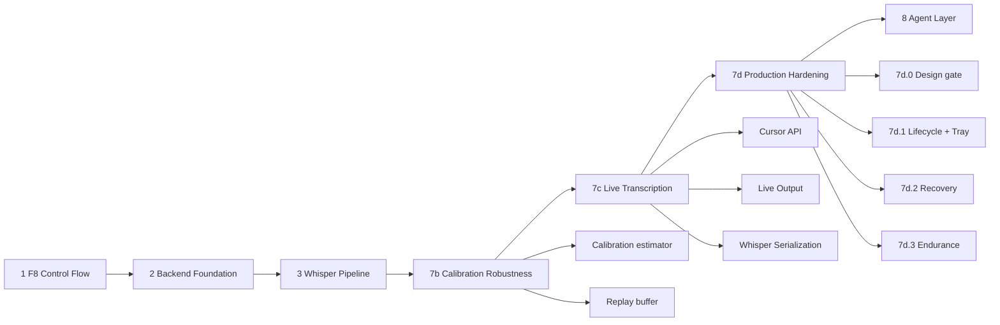

# Development progress

> Authority: `docs/HANDOVER.md` is the single source of truth. This file is supporting detail; if they disagree, HANDOVER.md wins.

Last updated: 2026-10-07

---

## Timeline

| Phase | Description | Commit | Status |
|---|---|---|---|
| 1 | F8 control flow | (history) | done |
| 2 | Backend foundation | (history) | done |
| 3 | Whisper pipeline | (history) | done |
| 65dc0af | Tray state precedence + processing failure feedback | `65dc0af` | pushed |
| 7327b12 | Runtime recovery foundation | `7327b12` | pushed |
| a396a38 | Runtime recovery + model validation boundary | `a396a38` | pushed |
| 7a | Streaming capture foundation | `f2207f7` | pushed |
| 7b | Live transcription pipeline | `5cc87fe` | pushed |
| 7b.4 | Calibration robustness | `2691031` | pushed |
| 7c | Live transcription delivery + serialization | `dd5d231` | pushed (HEAD) |
| 7d.0 | Design gate (F8/live exclusion, state model) | — | approved, no code |
| 7d.1 | Supervisor lifecycle + tray integration | **uncommitted** | manual UI validation passed 2026-10-07, awaiting commit approval |
| 7d.2 | Recovery / further hardening | — | not started (blocked on 7d.1 commit) |
| 8 | Agent layer | — | not started |

---

## 7d.1 detail

Implemented:

- `live_supervisor.py` (new): session lifecycle, `f8_request()` gate,
  `reconcile()` failure cleanup, `shutdown()` with flag-first ordering.
- `main.py`: gate in `f8_down`, supervisor shutdown in `cleanup`,
  startup restore of `live_mode_enabled`, main loop waits on
  `shutdown_event` + runs `reconcile()`.
- `tray.py`: Live Transcription menu item, live-aware status rendering,
  Exit performs real shutdown before `icon.stop()`.
- `app_state.py`: `live_status`.
- `config.py`: `live_mode_enabled` default.
- `test_live_supervisor.py`, `test_integration_7d.py`.

Evidence: 126/126 tests (re-run after validation), 7d.1 files lint-clean,
manual tray smoke test **PASS** — 8/8 scenarios on 2026-10-07, every
child process exited code 0, no leftover Whisper process, `git status`
unchanged (observations in `TEST_STATUS.md`).

Outstanding: request approval for the 7d.1 checkpoint commit, then start
7d.2. Open gap: no unit test covers `tray.update_tray` rendering
precedence.
